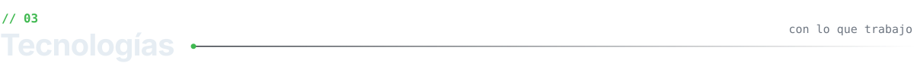

<!-- Perfil de GitHub de Fabrizio Palomino. Cada sección es un SVG con versión clara y oscura en ./assets -->

<picture>
  <source media="(prefers-color-scheme: dark)" srcset="./assets/hero-dark.svg">
  <source media="(prefers-color-scheme: light)" srcset="./assets/hero-light.svg">
  
</picture>

  

<picture>
  <source media="(prefers-color-scheme: dark)" srcset="./assets/h-sobre-mi-dark.svg">
  <source media="(prefers-color-scheme: light)" srcset="./assets/h-sobre-mi-light.svg">
  
</picture>

<picture>
  <source media="(prefers-color-scheme: dark)" srcset="./assets/sobre-mi-dark.svg">
  <source media="(prefers-color-scheme: light)" srcset="./assets/sobre-mi-light.svg">
  
</picture>

  

<picture>
  <source media="(prefers-color-scheme: dark)" srcset="./assets/h-proyectos-dark.svg">
  <source media="(prefers-color-scheme: light)" srcset="./assets/h-proyectos-light.svg">
  
</picture>

<a href="https://github.com/fpalomino-db/Tambo-">
<picture>
  <source media="(prefers-color-scheme: dark)" srcset="./assets/proyecto-tambo-dark.svg">
  <source media="(prefers-color-scheme: light)" srcset="./assets/proyecto-tambo-light.svg">
  
</picture>
</a>
<a href="https://github.com/fpalomino-db/MODELO-PREDICTIVO-DE-RETENCI-N-BANCARIA-kaggle-">
<picture>
  <source media="(prefers-color-scheme: dark)" srcset="./assets/proyecto-churn-dark.svg">
  <source media="(prefers-color-scheme: light)" srcset="./assets/proyecto-churn-light.svg">
  
</picture>
</a>

  

<picture>
  <source media="(prefers-color-scheme: dark)" srcset="./assets/h-tecnologias-dark.svg">
  <source media="(prefers-color-scheme: light)" srcset="./assets/h-tecnologias-light.svg">
  
</picture>

<picture>
  <source media="(prefers-color-scheme: dark)" srcset="./assets/stack-dark.svg">
  <source media="(prefers-color-scheme: light)" srcset="./assets/stack-light.svg">
  
</picture>

  

<picture>
  <source media="(prefers-color-scheme: dark)" srcset="./assets/h-ahora-dark.svg">
  <source media="(prefers-color-scheme: light)" srcset="./assets/h-ahora-light.svg">
  
</picture>

<picture>
  <source media="(prefers-color-scheme: dark)" srcset="./assets/ahora-dark.svg">
  <source media="(prefers-color-scheme: light)" srcset="./assets/ahora-light.svg">
  
</picture>

  

<picture>
  <source media="(prefers-color-scheme: dark)" srcset="./assets/h-contacto-dark.svg">
  <source media="(prefers-color-scheme: light)" srcset="./assets/h-contacto-light.svg">
  
</picture>

<a href="https://www.linkedin.com/in/ffpc/">
<picture>
  <source media="(prefers-color-scheme: dark)" srcset="./assets/btn-linkedin-dark.svg">
  <source media="(prefers-color-scheme: light)" srcset="./assets/btn-linkedin-light.svg">
  
</picture>
</a>
<a href="mailto:fabian_palomino20@hotmail.com">
<picture>
  <source media="(prefers-color-scheme: dark)" srcset="./assets/btn-correo-dark.svg">
  <source media="(prefers-color-scheme: light)" srcset="./assets/btn-correo-light.svg">
  
</picture>
</a>

  

<picture>
  <source media="(prefers-color-scheme: dark)" srcset="./assets/footer-dark.svg">
  <source media="(prefers-color-scheme: light)" srcset="./assets/footer-light.svg">
  
</picture>

